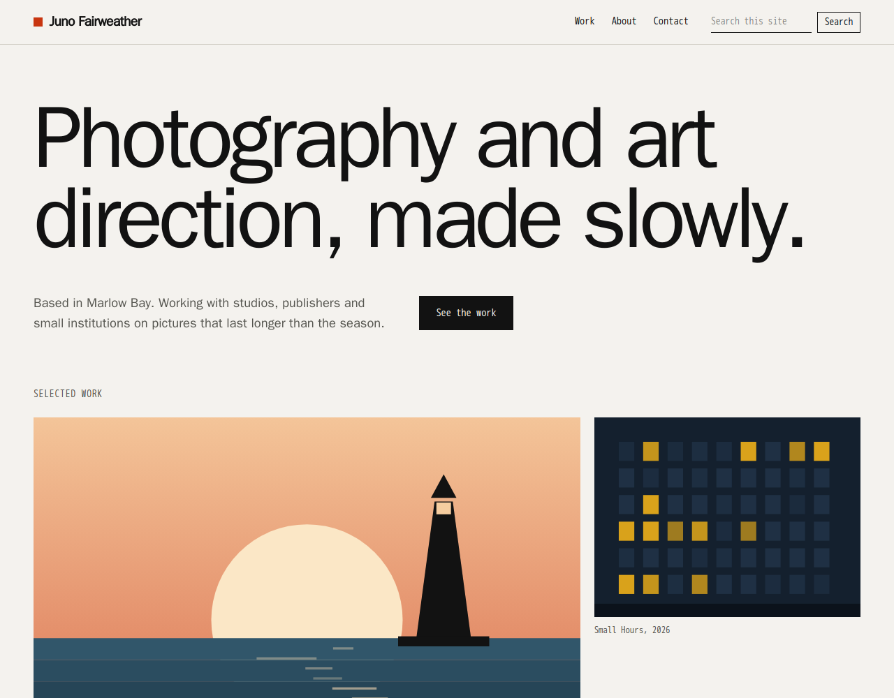

# polysite-theme-portfolio

**Portfolio (example)**: a minimal, image-led theme for a designer or photographer, for
[Polysite](https://github.com/polysites/polysite). It is a showcase theme: it ships a complete fictional demo site
(`showcase/`) to load as its own demo site.



## The look

- Paper and ink with one accent, the site's **primary colour** (a vermilion in the demo). Square corners, hairline rules.
- Heavy, tightly set system sans for display, system monospace for labels and captions. No web fonts.
- A statement hero, then pictures: the **gallery** block is an irregular 12-column rhythm of wide and narrow pictures, and
  `columns: 2` gives the even two-up used on project pages.
- Light and dark (`prefers-color-scheme`), `prefers-reduced-motion` respected, AA contrast, visible focus rings, no JavaScript
  needed for the menu (it is a short plain list).

## What it draws

| Part | How |
| --- | --- |
| Layout (`layouts/portfolio.vue`) | Wordmark and plain-text menu, the **search** box and **language switcher** slots, the **share** slot, and a footer that sets the site's tagline as a huge closing statement |
| Blocks it restyles | `hero`, `textBlock` (label left, text right), `featureGrid` (ruled numbered rows), `formEmbed` (underlined fields). Everything else comes from the parent theme (the starter) |
| Blocks-pack blocks | CSS only: `gallery`, `logos` (a monospace list), `testimonials` (large quote), `stats` and `timeline` (ruled), `team` (portrait and bio), `cta` (an accent-colour band), `hours-contact` |
| Project pages | Ordinary pages with a slug like `work/harbour-light`: a text block, `stats` as a fact sheet and a two-column `gallery` |

## Using it

Mount this folder as `themes/polysite-theme-portfolio/`, restart the CMS and web containers, and choose **Portfolio (example)** for a
site under **Sites**. Its demo content is `showcase/site.json`.

## Files

```text
layouts/portfolio.vue         the site chrome
components/portfolio/         the blocks it draws itself
assets/css/portfolio.css      all of the styling, scoped to .theme-portfolio
showcase/site.json            the fictional demo site (Juno Fairweather): six pages and an enquiry form
showcase/images/              original SVG artwork, generated for the demo
showcase/screenshot.png       the picture used in the docs gallery
```

Everything in `showcase/` is made up: the photographer, the clients, the projects and every picture.

## License

Polysite Source-Available License, version 1.0, see [LICENSE.md](LICENSE.md).
