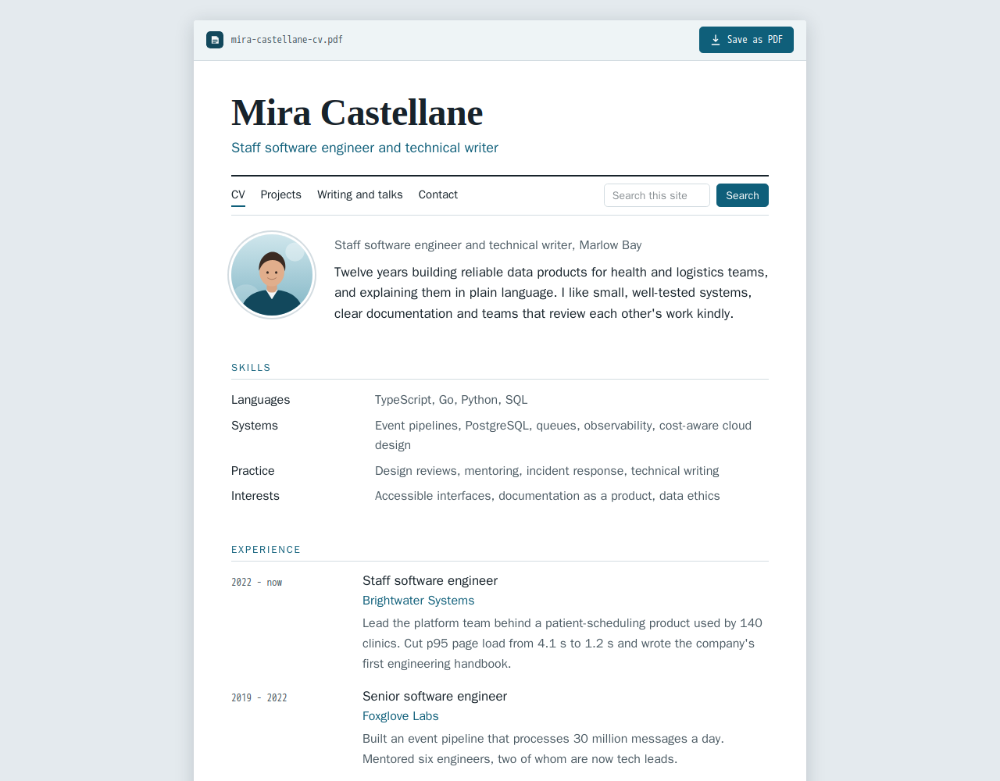

# polysite-theme-resume

**Resume (example)**: a personal CV site, for [Polysite](https://github.com/polysites/polysite). It is a showcase theme:
it ships a complete fictional demo site (`showcase/`) to load as its own demo site.



## The look

- One narrow column on a sheet of paper on a grey desk. A serif for the name, a sans for text, a monospace for dates; one accent
  (the site's **primary colour**, a deep teal in the demo). No web fonts.
- A **document bar** at the top shows a file name (`<site-name>-cv.pdf`) and a **Save as PDF** button, which opens the browser's
  print dialog.
- Light and dark (`prefers-color-scheme`), `prefers-reduced-motion` respected, AA contrast, visible focus rings.

## Print

`@media print` in `assets/css/resume.css` turns the **home page** into a clean one-page A4 CV: the document bar, menu, search,
share buttons, footer, testimonials and call-to-action bands disappear; type drops to 9.5 pt; the timeline keeps its date column;
links lose their colour. Use Save as PDF, or Print and choose "Save as PDF". The demo's home page (summary, skills, experience,
education) is written to fit one page.

## What it draws

| Part | How |
| --- | --- |
| Layout (`layouts/resume.vue`) | Document bar, name and role (the site's name and tagline), a plain menu with the **search** and **language switcher** slots, the **share** slot and a small footer |
| Blocks it restyles | `leaderSpotlight` (the summary: portrait, title and a paragraph), `featureGrid` (skills as a definition list), `commitmentsGrid` (projects), `textBlock`, `formEmbed` |
| Blocks-pack blocks | CSS only: `timeline` (dates in a column, used for experience, education, talks and articles), `stats`, `logos`, `testimonials`, `cta`, `hours-contact` |

## Using it

Mount this folder as `themes/polysite-theme-resume/`, restart the CMS and web containers, and choose **Resume (example)** for a
site under **Sites**. Its demo content is `showcase/site.json`.

## Files

```text
layouts/resume.vue         the site chrome
components/resume/         the blocks it draws itself
assets/css/resume.css      all of the styling and the print stylesheet, scoped to .theme-resume
showcase/site.json         the fictional demo site (Mira Castellane): four pages and a contact form
showcase/images/           original SVG artwork, generated for the demo
showcase/screenshot.png    the picture used in the docs gallery
```

Everything in `showcase/` is made up: the person, the employers, the schools, the projects and every picture.

## License

Polysite Source-Available License, version 1.0, see [LICENSE.md](LICENSE.md).
