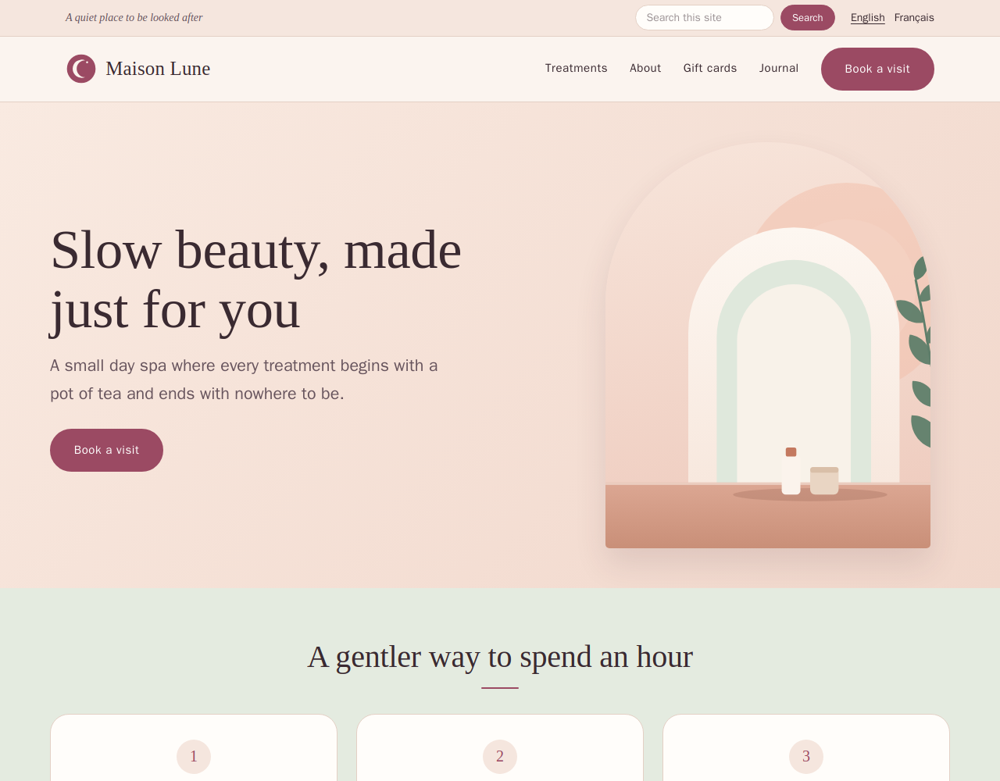

# polysite-theme-salon

**Salon (example)**: a soft, warm, elegant theme for a day spa or beauty parlour, for
[Polysite](https://github.com/polysites/polysite). It is one of the showcase themes: it ships a complete fictional demo
site (`showcase/`) to load as its own demo site.



## The look

- Warm cream and blush, a deep plum footer and call-to-action band, and one accent colour: the site's **primary colour**.
- Serif headings (a system stack: Iowan Old Style, Palatino, Georgia), a plain system sans for text. No web fonts.
- Arch-topped hero picture, round team portraits, pill buttons, hairline rules, generous space.
- Follows the visitor's light or dark preference (`prefers-color-scheme`) and respects `prefers-reduced-motion`. Text is AA
  contrast in both. Every control has a visible focus ring, and the small-screen menu is a real button (`aria-expanded`).

## What it draws

| Part | How |
| --- | --- |
| Layout (`layouts/salon.vue`) | A thin top bar with the tagline, the **search** box and the **language switcher** (plugin slots); the logo and menu; the plugin's **share** slot after the content; a footer with the footer columns and social links. The **last menu item is drawn as the booking button**, so the site's menu decides where it goes |
| Blocks it restyles | `hero` (words plus an arch-shaped picture), `textBlock`, `featureGrid`, `faqAccordion`, `formEmbed` (a booking card). The other core blocks come from the parent theme, the starter |
| Blocks-pack blocks | Restyled with CSS only (`assets/css/salon.css`): `price-list` as cards with dotted leaders, `pricing` with a plum recommended plan, `testimonials` as large quotes, `team` with round portraits, `gallery`, `cta`, `hours-contact`, `stats`, `timeline`, `schedule`, `logos` |
| Plugins | Posts (the *Journal*), search, share buttons, languages |

## Using it

Mount this folder as `themes/polysite-theme-salon/`, restart the CMS and web containers, and choose **Salon (example)** for a site
under **Sites**. Set the site's two colours: the primary is the accent, and the secondary is the footer and call-to-action
background, so choose a dark one.

Its demo content is `showcase/site.json`.

## Files

```text
layouts/salon.vue         the site chrome
components/salon/         the blocks it draws itself
assets/css/salon.css      all of the styling, scoped to .theme-salon (tokens at the top)
showcase/site.json        the fictional demo site (Maison Lune): five pages, three journal posts, a booking form
showcase/images/          original SVG artwork, drawn for the demo
showcase/screenshot.png   the picture used in the docs gallery
```

Everything in `showcase/` is made up: the business, the people, the address, the phone number and every picture.

## License

Polysite Source-Available License, version 1.0, see [LICENSE.md](LICENSE.md).
